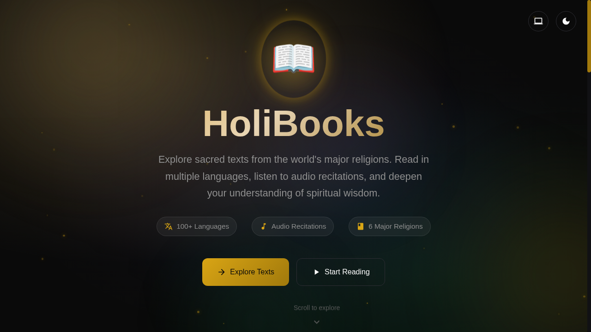
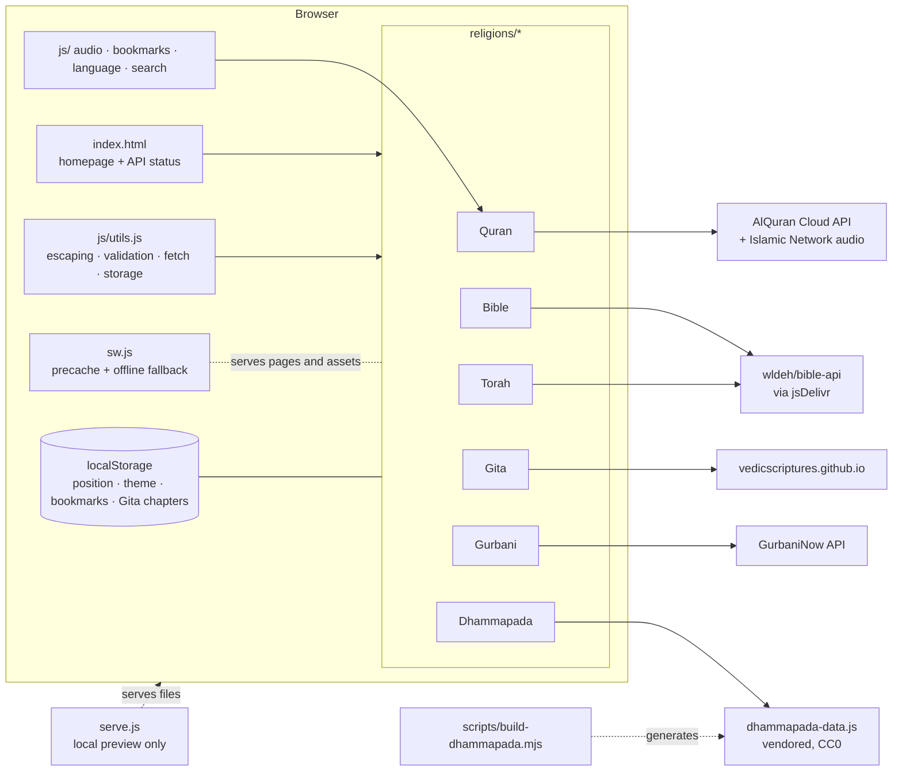

<p align="center">
  
</p>

<p align="center"><b>Six sacred texts. One distraction-free reader.</b></p>

<p align="center">
  <a href="https://github.com/muhib-karim/HoliBooks/actions/workflows/ci.yml"></a>
  <a href="LICENSE"></a>
  
  
</p>

# HoliBooks

HoliBooks is a browser reader for the **Quran, Bible, Torah, Bhagavad Gita, Guru Granth Sahib and Dhammapada**. It is a static site in plain HTML, CSS and JavaScript: no framework, no build step, no npm dependencies. Five readers fetch their text from public scripture APIs when a page is opened. The Dhammapada ships with the site as public-domain data.

The code is MIT licensed. **The scripture texts and translations are not**: each belongs to its source, listed under [Data sources and licences](#data-sources-and-licences).

[Report an issue](https://github.com/muhib-karim/HoliBooks/issues) · [Changelog](CHANGELOG.md) · [MIT license](LICENSE)

## Screenshot



*Homepage captured 11 October 2026, before version 2.0.2. The "100+ Languages" badge in the page is an unverified figure: the Quran reader offers 29 translations.*

## Quick start

You need Node.js 18 or newer. There is nothing to install.

```bash
git clone https://github.com/muhib-karim/HoliBooks.git
cd HoliBooks
npm run dev            # serves http://127.0.0.1:3000
```

Set `PORT` for another port (`PORT=8080 npm run dev`). Open the pages over HTTP, not `file://`. The readers need network access to reach the scripture APIs.

| Command | What it does |
|---------|--------------|
| `npm run dev` / `npm start` | Start the local preview server |
| `npm test` | Run the offline test suite (no network, no secrets) |
| `npm run check` | Syntax-check every tracked JavaScript file |
| `npm run test:apis` | Optional live check of every API endpoint and edition the readers use. Exits non-zero on any failure |
| `node scripts/build-dhammapada.mjs` | Rebuild the Dhammapada data file from SuttaCentral (needs network) |
| `npm run deploy` | Deploy to Vercel with `npx vercel`. Needs the owner's account |

## Features

- **Six readers**, one page each under `religions/<tradition>/`, with previous/next navigation, deep links (`?surah=2&verse=255`, `?book=john&chapter=3`, `?chapter=12`, `?page=6`, `?verse=100`) and the last position remembered in `localStorage`.
- **Translation choice** where the source offers one: 29 Quran translations, three Bible versions, three Torah editions including Hebrew, English or Hindi for the Gita.
- **Quran audio**, verse by verse, with speed control (`js/audio-player.js`).
- **Bookmarks** kept in `localStorage`, with export (`js/bookmarks.js`).
- **Offline app shell**: a service worker (`sw.js`) precaches every page, style and script, so the app opens offline after one visit. Chapters you have already read are served from cache; unread text still needs the network.
- **Installable**: web app manifest with 192px and 512px icons.
- **Dark and light themes**.
- **API status badge** on the homepage that requests each API once per page load and reports the real result (`js/api-monitor.js`).
- **Sample search** (`Ctrl+K` on the Quran page): it searches six built-in verses, not the full texts. See [Limitations](#limitations).

## Architecture



- **Static site.** Every page is a plain HTML file that loads `js/utils.js` and then its reader script as classic `<script>` tags. Production hosting is any static host (Vercel is configured).
- **Shared rules live in `js/utils.js`.** Anything from an API, the URL or `localStorage` is escaped with `HoliBooks.escapeHTML` before it reaches `innerHTML`, numbers are range-checked with `clampInt`, and each reader ignores responses that a newer request has overtaken.
- **Failure is explicit.** When an API cannot be reached a reader shows an error for what was requested, with a Retry button. No sample text is shown in its place.
- **Service worker.** Pages are fetched network-first (so a new deployment is seen at once) and fall back to the precache offline. Same-origin assets are cache-first. Quran, Bible and Gurbani API responses are network-first with a cache fallback. The Gita reader keeps its own compact per-chapter cache instead, because the API serves one large response per verse.
- **`serve.js`** is for local preview only. It binds to `127.0.0.1`, accepts GET and HEAD, rejects path traversal and symlink escapes, never serves dotfiles, and answers only requests whose `Host` header names the local machine.

## Data sources and licences

The MIT licence covers this repository's code. It does not cover the texts below. "Not stated" means the source does not publish terms for that item; it does not mean the item is free to reuse.

| Reader | Source | What is shown | Reaches the page | Licence or terms |
|--------|--------|---------------|------------------|------------------|
| Quran | [AlQuran Cloud API](https://alquran.cloud/api) (`api.alquran.cloud/v1`) | Arabic text; a translation chosen by the reader, default `en.sahih` (Saheeh International). 29 translations are offered | Fetched when a surah is opened | Each edition belongs to its translator or publisher. Not stated per edition by the API |
| Quran audio | Islamic Network CDN (`cdn.islamic.network`) | Recitation by Mishary Alafasy (`ar.alafasy`) | Streamed on play | Not stated |
| Bible | [`wldeh/bible-api`](https://github.com/wldeh/bible-api) through jsDelivr | King James Version, World English Bible, American Standard Version | Fetched per chapter | KJV and ASV are marked "PUBLIC DOMAIN" in the dataset's metadata. The WEB entry's copyright field is blank |
| Torah | same dataset | JPS 1917 Tanakh (`en-ojps`, default), Westminster Leningrad Codex in Hebrew (`he-wlc`), King James Version | Fetched per chapter | KJV as above. The copyright field is blank for `en-ojps` and `he-wlc` |
| Bhagavad Gita | [vedicscriptures.github.io](https://vedicscriptures.github.io) | Sanskrit and transliteration. English: Shri Purohit Swami (1935), or Swami Sivananda where Purohit Swami merged a verse into its neighbour (the verse then names him). Hindi: Swami Tejomayananda, or Swami Ramsukhdas | Fetched per verse, then cached per chapter in `localStorage` | Not stated by the API. The translations belong to their translators' publishers |
| Guru Granth Sahib | [GurbaniNow API](https://github.com/GurbaniNow/gurbaninow-api) (`api.gurbaninow.com/v2`) | Gurmukhi, transliteration and the API's default English translation, which matched Dr. Sant Singh Khalsa's translation in a line-by-line check | Fetched per Ang | Not stated by the API |
| Dhammapada | [SuttaCentral `bilara-data`](https://github.com/suttacentral/bilara-data), pinned commit recorded in the data file | Pali: Mahāsaṅgīti edition. English: Bhikkhu Sujato | **Vendored** in `religions/buddhism/dhammapada-data.js` | Both dedicated to the public domain, [CC0 1.0](https://creativecommons.org/publicdomain/zero/1.0/) (stated by SuttaCentral) |

Text that lives in this repository:

- **The Dhammapada**, as above (CC0).
- **Six short quotations** on the homepage and in the sample search, each naming its translation: Marmaduke Pickthall's Quran (1930), the World English Bible, Sir Edwin Arnold's Gita (*The Song Celestial*, 1885), Bhikkhu Sujato's Dhammapada, a saying from the Talmud (Shabbat 31a), and one line of Japji Sahib in a literal rendering written for this project, credited "tr. HoliBooks".
- **Test fixtures** in `tests/fixtures/` keep source-language text (and the King James Version) and replace every other translation with placeholders. See the README in that directory.

No other scripture translation is stored in the repository. Earlier versions bundled several; they were removed in 2.0.2.

## Testing

```bash
npm test
```

The suite has **104 tests in 12 files**, run by the built-in `node:test` runner with no dependencies and no network. Reader scripts are loaded unmodified into a `node:vm` context with a small fake DOM (`tests/helpers/browser-env.mjs`), and API responses come from recorded fixtures.

| File | Tests | Covers |
|------|------:|--------|
| `tests/utils.test.mjs` | 9 | Escaping, range checks, verse de-duplication, Retry wiring, blocked storage, fetch timeout and retry rules |
| `tests/bible-torah.test.mjs` | 14 | Book and version IDs, deep links, duplicated verses, Hebrew rendering, saved-state validation, error and Retry, stale responses |
| `tests/quran.test.mjs` | 10 | Bismillah shown once, escaping, surah validation, API-down behaviour, browser history, stale responses, keyboard |
| `tests/gita.test.mjs` | 11 | Per-verse loading and concurrency, numbering, translators and the merged-verse placeholder, chapter cache, partial failure |
| `tests/gurbani.test.mjs` | 5 | Fields read from the real response shape, language modes, escaping, Ang validation, error and Retry |
| `tests/dhammapada.test.mjs` | 8 | All 423 verses present and distinct, known verses, source and licence header, reader behaviour |
| `tests/shared-modules.test.mjs` | 12 | Bookmarks, audio player and language selector against corrupt storage; audio speed, errors and playlist ends |
| `tests/home-search-monitor.test.mjs` | 11 | Homepage citations, search links and history, API status badge |
| `tests/sw.test.mjs` | 8 | The real service worker against a fake cache: precache matches page requests, offline shell, install failure, activation |
| `tests/static-integrity.test.mjs` | 8 | Local links resolve, manifest icons exist at their declared sizes, one version string everywhere, scripts parse |
| `tests/server.test.mjs` | 4 | `serve.js`: content, 404s, traversal, dotfiles, `Host` check, headers |
| `tests/api-smoke.test.mjs` | 4 | The live-check tool itself, against fake responses |

What the tests do not cover: rendering in a real browser, CSS, audio playback, and the live APIs. `npm run test:apis` checks the live endpoints and is kept out of CI so that third-party downtime does not fail a build.

### Continuous integration

[`.github/workflows/ci.yml`](.github/workflows/ci.yml) runs on pull requests and on pushes to `master`:

- **Syntax and tests** on Node 18, 20 and 22: `node --check` on every tracked `.js` and `.mjs` file, then the suite.
- **Secret scan**: gitleaks over the full git history (`fetch-depth: 0`), using a release binary verified against its published checksum.

## Project structure

```
index.html              Homepage linking to the six readers
offline.html            Service-worker offline fallback
manifest.json, sw.js    PWA manifest and service worker
assets/                 Icons and card artwork
css/                    Global styles and animations
js/                     Shared browser modules (utils, audio, bookmarks, language, search, API monitor)
religions/<name>/       One reader per tradition: .html + .css + .js
religions/buddhism/dhammapada-data.js   Generated Dhammapada text (CC0)
scripts/                build-dhammapada.mjs
serve.js                Local-only preview server
test-apis.js            Optional live API check (CLI + module)
tests/                  Offline node:test suite, helper and fixtures
docs/, screenshots/     README images and PWA screenshots
```

## Limitations

- **Search is a sample.** It matches six built-in verses and is available only on the Quran page. Full-text search is not implemented.
- **The Gita loads one request per verse**, because the API has no per-chapter endpoint: 20 to 78 requests of roughly 16 to 100 KB each the first time a chapter is opened. After that the chapter comes from `localStorage`.
- **Upstream data quality passes through.** The World English Bible text in the dataset contains translator footnotes inside some verses. The dataset also repeats verses; the readers remove the repeats.
- **Offline covers the app shell and what you have already read.** Unread chapters, and Quran audio, need the network.
- **No production security headers.** The repository has no `vercel.json`, so the deployed site sends no Content-Security-Policy. A useful policy needs the inline scripts moved out first.
- **Language coverage differs by text**: 29 translations for the Quran; English translations only for the Bible and Gurbani; English and Hebrew for the Torah; English and Hindi for the Gita; Pali and English for the Dhammapada.
- **HoliBooks is a reading tool, not an authoritative edition.** Verify text against its source before quoting it.

## Contributing

Run `npm test` and `npm run check` before opening a pull request. A change to a reader should come with a test in `tests/`. If you change an API URL, a version or an edition ID, run `npm run test:apis` and add the new endpoint to `test-apis.js`. Do not add translation text to the repository unless its licence allows it and the [data sources table](#data-sources-and-licences) says so.

When reporting a problem, include the reader URL, the browser, and the text and translation selected.

## License

The application code is released under the [MIT License](LICENSE). Texts, translations and audio belong to their sources: see [Data sources and licences](#data-sources-and-licences).
