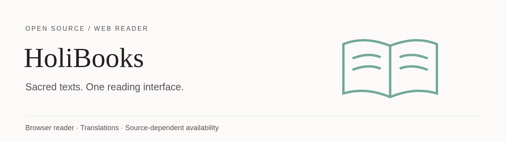
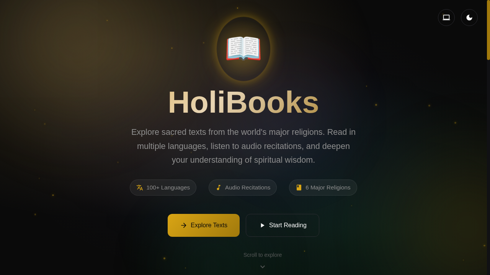

<p align="center"></p>

# HoliBooks

A browser reader for the Quran, Bible, Bhagavad Gita, Torah, Guru Granth Sahib and Dhammapada. The interface links to religious-text readers, translations and audio where supported by the selected source.

[Open the site](https://holibooks.vercel.app/) · [Report an issue](https://github.com/muhib-karim/HoliBooks/issues) · [MIT license](LICENSE)

## See the interface



This screenshot is the live homepage captured on 11 October 2026. Its "100+ Languages" badge is an unverified coverage count, not a measured claim endorsed by this README. The dated browser check on 11 October 2026 loaded Al-Faatiha in the Quran reader with Arabic text and an English translation. This is a point-in-time check, not an ongoing guarantee. Other readers, all translations, audio playback and offline operation were not fully verified in that session.

## Run locally

Use Node.js 18 or newer. The static preview binds to localhost, not the public network.

```bash
git clone https://github.com/muhib-karim/HoliBooks.git
cd HoliBooks
npm run dev
```

Open `http://127.0.0.1:3000`. No install step is needed for this preview: it uses Node's built-in modules. External text APIs still need network access. Do not open reader pages through `file://`, where browser origin restrictions may block requests.

## Checks

```bash
npm test                # Offline local-server regression tests
npm run test:apis       # Optional network smoke check of four external APIs
```

Offline tests also check the API smoke helper with deterministic responses, network errors and an active-but-unfinished response deadline.

The local test checks startup, HTML serving, query strings, missing files, malformed paths, traversal rejection, unsupported methods and HEAD responses. The CI workflow runs these server checks on Node 18, 20 and 22. A passing server check does not prove the external reader APIs, audio or browser interactions work.

The API smoke check calls the Quran, Bible, Gita and Gurbani source endpoints. It has a request timeout and exits nonzero on failed responses. It is separate from offline CI because third-party downtime or throttling is not a local-server regression. It is not a complete reader or language-coverage test.

## Architecture

- Static HTML, CSS and JavaScript reader pages.
- `index.html` provides the homepage and links to the reader pages.
- `serve.js` is a local preview server. It is not a production hosting server.
- `test-apis.js` checks selected external API responses.
- `tests/server.test.mjs` tests the local preview without paid services or secrets.

## Operating limits

- Language coverage differs by text and upstream provider. No single verified language count is claimed here.
- Network availability, API policy, CORS and source changes can affect reading and audio.
- Cached or installed PWA behavior does not guarantee complete offline access to every text and translation. Verify your required content before relying on it offline.
- Text and translation rights belong to their respective sources. The code's MIT license does not grant rights to third-party content.
- Treat this as a reading tool, not an authoritative substitute for checking editions and translations.

## Contributing

Reproduce an issue with the reader URL, browser, selected text and language. Do not include API keys or private reading history in a public issue. Run the offline server tests before a PR. Reader behavior changes should include browser evidence and a note about the affected external source.

## License

The application code is MIT-licensed. See [LICENSE](LICENSE). Check the upstream text or translation source for its own terms.
